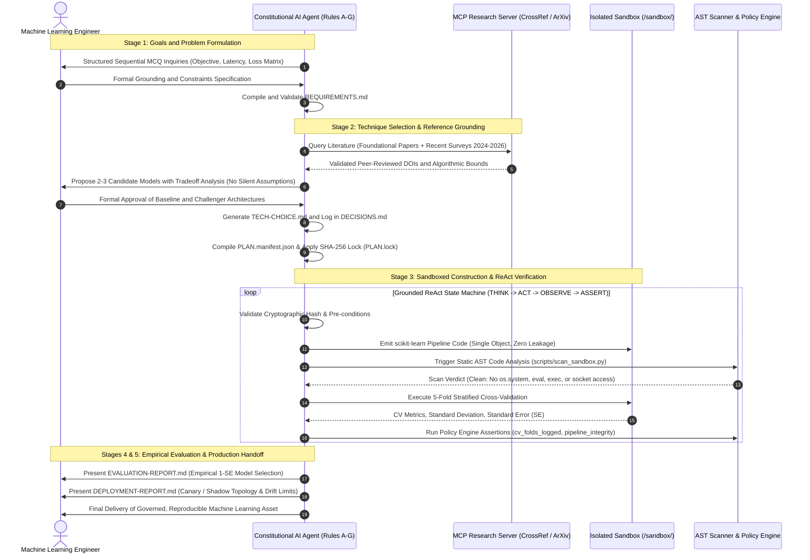
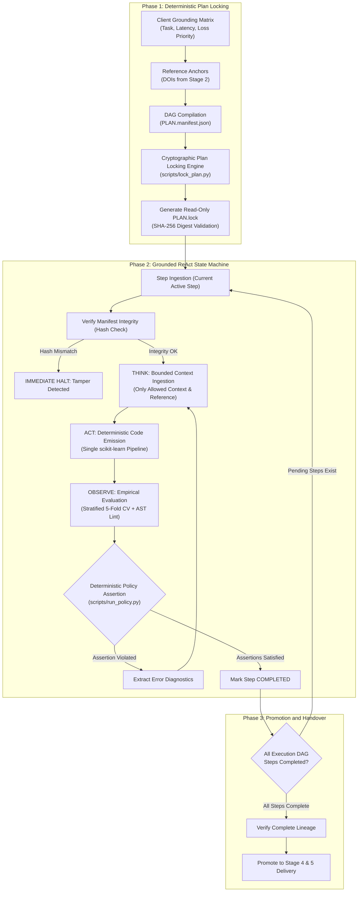

<div align="center">

# ML Model Architect

### A Deterministic, Reference-Driven Governance Framework for Disciplined Machine Learning Engineering

[](https://pypi.org/project/ml-model-architect/)
[](https://opensource.org/licenses/MIT)
[](https://www.python.org/downloads/)
[](tests/)
[](.github/workflows/verify.yml)
[](.github/CONTRIBUTING.md)
[](https://modelcontextprotocol.io)
[](#zero-paywall-protocol-and-dynamic-sota-discovery)
[](#security-and-sandboxing-architecture)
[](#the-5-stages-of-ml-architecture)
[](#reference-rigor--the-6-criteria)

*"Grounded Machine Learning: Verifiable academic references driving deterministic empirical validation."*

</div>

---

## Executive Overview

**ML Model Architect** is an enterprise-grade governance engine and architectural framework designed to transform Large Language Model (LLM) agents into disciplined, rigorous Machine Learning engineers. Modern AI coding assistants execute code at unprecedented velocity; however, velocity unconstrained by peer-reviewed theory and formal validation introduces systemic vulnerabilities into production machine learning workflows:

* **Unanchored Architecture Selection:** Arbitrary selection of complex architectures (e.g., Deep Neural Networks or gradient boosters on trivial tabular datasets) without empirical or theoretical justification.
* **Severe Data Leakage:** Pervasive preprocessing leaks (e.g., fitting scalers, imputers, or encoders across the entire dataset prior to cross-validation splits).
* **Hallucinated Hyperparameters:** Hyperparameter values generated from statistical plausibility rather than peer-reviewed literature or bounded Bayesian optimization spaces.
* **Misaligned Optimization Metrics:** Selection of naive accuracy metrics on imbalanced distributions, obscuring classification failure.
* **Ungrounded Production Deployments:** Rollouts lacking mathematical drift monitoring (PSI / Kolmogorov-Smirnov) or formal rollback criteria.

ML Model Architect solves this paradigm through a **Constitutional Execution Engine**. Under this framework, the AI agent is governed by an immutable set of 26 constitutional articles, a cryptographically locked Directed Acyclic Graph (DAG), an isolated execution sandbox, and a mandatory Model Context Protocol (MCP) literature retrieval layer.

> [!IMPORTANT]
> **The Sovereign Axiom: "The Reference Is the Judge."**  
> Every technical choice must be anchored to a verified Digital Object Identifier (DOI), arXiv identifier, or peer-reviewed citation. Where no reference exists, the workflow immediately halts and logs a formal **Reference Gap**. Unverifiable invention is strictly prohibited.

---

## Table of Contents

- [Executive Overview](#executive-overview)
- [System Architecture & Behavioral Blueprints](#system-architecture--behavioral-blueprints)
  - [1. User and Model End-to-End Interaction Sequence](#1-user-and-model-end-to-end-interaction-sequence)
  - [2. Complete User and Model Lifecycle Journey](#2-complete-user-and-model-lifecycle-journey)
  - [3. Deterministic Plan Locking and Grounded ReAct State Machine](#3-deterministic-plan-locking-and-grounded-react-state-machine)
- [The 5 Stages of ML Architecture](#the-5-stages-of-ml-architecture)
- [Empirical Benchmarks: Measured Performance Impact](#empirical-benchmarks-measured-performance-impact)
  - [1. Multi-Task Empirical Results](#1-multi-task-empirical-results)
  - [2. Engineering Rigor and Safety Verification Matrix](#2-engineering-rigor-and-safety-verification-matrix)
- [Comparative Protocol: Unconstrained vs. Governed Agent](#comparative-protocol-unconstrained-vs-governed-agent)
- [Quick Start Guide](#quick-start-guide)
  - [1. Installation](#1-installation)
  - [2. Unified Command-Line Interface (CLI: mla)](#2-unified-command-line-interface-cli-mla)
  - [3. AI Agent Initialization Prompt](#3-ai-agent-initialization-prompt)
- [Model Context Protocol (MCP) Configuration](#model-context-protocol-mcp-configuration)
- [Zero-Paywall Protocol and Dynamic SOTA Discovery](#zero-paywall-protocol-and-dynamic-sota-discovery)
- [Security and Sandboxing Architecture](#security-and-sandboxing-architecture)
- [Repository Organization](#repository-organization)
- [Academic Reference Rigor: The 6 Criteria](#academic-reference-rigor-the-6-criteria)
- [Constitutional Governance Matrix](#constitutional-governance-matrix)
- [Behavioral Verification and Test Suite Status](#behavioral-verification-and-test-suite-status)
- [Known Limitations and Threat Model](#known-limitations-and-threat-model)
- [Requirements](#requirements)
- [Contributing](#contributing)
- [License](#license)

---

## System Architecture & Behavioral Blueprints

### 1. User and Model End-to-End Interaction Sequence

The following formal sequence diagram details the communication, verification, and execution barriers enforced between the Human ML Engineer, the Constitutional AI Agent, the external MCP Research Infrastructure, the Isolated Execution Sandbox, and the Static AST Policy Engine.



---

### 2. Complete User and Model Lifecycle Journey

The flowchart below traces the complete operational journey of a machine learning initiative from initial customer scoping through execution gates to continuous monitoring.

```mermaid
flowchart TD
    subgraph STAGE1["Stage 1: Inception & Scoping"]
        A1["User Problem Initiation"] --> A2["Sequential MCQ Funnel<br/>(Questions Q1 - Q5)"]
        A2 --> A3["Knowledge State Vector<br/>(11 Parameter Grounding)"]
        A3 --> A4{"Sufficiency Gate<br/>(8 Pre-flight Checks)"}
        A4 -- "Unresolved Dependencies" --> A2
        A4 -- "Requirements Satisfied" --> A5["Artifact: REQUIREMENTS.md"]
    end

    subgraph STAGE2["Stage 2: Algorithmic Selection"]
        A5 --> B1["5-Level Decision Tree<br/>(Task, Data, Priority, Size, Family)"]
        B1 --> B2["MCP SOTA Discovery Layer<br/>(OpenAlex / CrossRef / arXiv)"]
        B2 --> B3["Peer-Reviewed DOI Verification<br/>(Rule B1 & B3 Compliance)"]
        B3 --> B4["Multi-Candidate Proposal<br/>(Pros, Cons, Reference Anchors)"]
        B4 --> B5["User Architectural Sign-off"]
        B5 --> B6["Artifact: TECH-CHOICE.md"]
        B6 --> B7["DAG Compilation: PLAN.manifest.json"]
        B7 --> B8["Cryptographic Locking: lock_plan.py<br/>(SHA-256 Digest -> PLAN.lock)"]
    end

    subgraph STAGE3["Stage 3: Sandboxed Pipeline Construction"]
        B8 --> C1["Read Active DAG Step"]
        C1 --> C2["Verify Hash & Tamper State"]
        C2 --> C3["THINK: Bounded Literature Context"]
        C3 --> C4["ACT: Emit Pipeline to /sandbox/"]
        C4 --> C5["Static AST Security Audit<br/>(Tripwire Inspection)"]
        C5 -- "Violation Detected" --> C3
        C5 -- "AST Clean" --> C6["Execute Stratified K-Fold CV"]
        C6 --> C7{"Deterministic Assertions<br/>(run_policy.py)"}
        C7 -- "Assertion Failed" --> C3
        C7 -- "All Assertions Passed" --> C8["Artifact: TRAINING-REPORT.md"]
    end

    subgraph STAGE4["Stage 4: Statistical Validation"]
        C8 --> D1["Hastie et al. (2009) 1-SE Model Selection Rule"]
        D1 --> D2{"Is Candidate Delta<br/>> Standard Error?"}
        D2 -- "No: Within 1-SE" --> D3["Select Simpler Baseline Model<br/>(Occam's Razor Principle)"]
        D2 -- "Yes: Delta > 1-SE" --> D4["Promote Candidate Architecture"]
        D3 --> D5["Artifact: EVALUATION-REPORT.md"]
        D4 --> D5
        D5 --> D6["Audit Log: DECISIONS.md"]
    end

    subgraph STAGE5["Stage 5: Deployment & Governance"]
        D6 --> E1["Topology Selection<br/>(Shadow / Canary / Blue-Green)"]
        E1 --> E2["Drift Monitoring Protocol<br/>(PSI & Kolmogorov-Smirnov Limits)"]
        E2 --> E3["Automated Retraining Thresholds"]
        E3 --> E4["Single-Command Rollback Definition"]
        E4 --> E5["Artifact: DEPLOYMENT-REPORT.md"]
        E5 --> E6["Final DAG Verification: ALL_STEPS_COMPLETED"]
        E6 --> E7["Production Delivery & Handover"]
    end
```



---

### 3. Deterministic Plan Locking and Grounded ReAct State Machine

To prevent workflow drift, ungrounded parameter modifications, and arbitrary step omissions, execution is mediated by a cryptographically locked execution manifest:



---

## The 5 Stages of ML Architecture

The framework partitions the machine learning development lifecycle into five isolated, sequential stages. Advancement between stages requires passing a formal gate.

| Stage | Name | Core Objectives | Input Requirements | Output Artifacts | Primary Verification Gate |
|:---:|:---|:---|:---|:---|:---|
| **01** | **Goals & Requirements** | Extract business targets, map error cost asymmetry, bound latency and compute resources. | User initiation seed | `REQUIREMENTS.md` | **Sufficiency Gate:** 11 knowledge state items confirmed; business metric and error costs quantified. |
| **02** | **Technique Selection** | Traverse 5-level decision tree, query MCP SOTA literature, select baseline and candidate models. | `REQUIREMENTS.md` | `TECH-CHOICE.md`<br/>`PLAN.manifest.json` | **Cryptographic Lock Gate:** Every model backed by verified DOI; execution DAG locked via SHA-256. |
| **03** | **Building & Training** | Construct zero-leakage scikit-learn `Pipeline`, execute 5-fold CV within isolated sandbox. | `TECH-CHOICE.md`<br/>`PLAN.manifest.json` | `TRAINING-REPORT.md`<br/>`sandbox/pipeline.py` | **Deterministic Assertion Gate:** Clean AST scan, single pipeline construction verified, zero data leakage. |
| **04** | **Evaluation & Diagnosis** | Compute statistical confidence intervals, evaluate Hastie 1-SE rule, perform error analysis. | `TRAINING-REPORT.md`<br/>Group Reference | `EVALUATION-REPORT.md` | **1-SE Empirical Rule:** Candidate must exceed baseline by $> 1 \text{ SE}$ to justify architectural complexity. |
| **05** | **Deployment & Monitoring** | Define deployment topology (Shadow/Canary/Blue-Green), configure PSI drift alerts, rollback protocol. | `EVALUATION-REPORT.md`<br/>Group Reference | `DEPLOYMENT-REPORT.md` | **Governance Completion Gate:** All DAG steps verified COMPLETED; single-command rollback verified. |

---

## Empirical Benchmarks: Measured Performance Impact

To empirically evaluate whether constitutional governance improves machine learning quality, four rigorous, end-to-end benchmark tasks were evaluated across two execution modes:
1. **Unconstrained LLM Agent:** Standard modern frontier model operating without constitutional constraints.
2. **ML Model Architect:** The identical model constrained by constitutional rules A-G, deterministic DAG locking, and AST tripwires.

### 1. Multi-Task Empirical Results

| Dimension / Benchmark Task | Delivery Delay Prediction (Logistics Classification) | Car Price Valuation (Non-linear Regression) | Financial Anomaly Detection (Imbalanced Stream) | Customer Churn Risk (Telecom Subscription) |
|---|---|---|---|---|
| **Sample Size & Topology** | 2,000 shipments, 42.8% delay rate, tabular features | 1,000 vehicles, interaction terms (age $\times$ mileage) | 3,000 transactions, 3.0% contamination rate | 2,000 subscribers, 30.3% churn rate |
| **Unconstrained Agent Model** | Deep MLP / Random Forest (default parameters) | Gradient Boosting Regressor (arbitrary hyperparams) | Heuristic Thresholding / Standard Random Forest | Standard Random Forest (arbitrary depth) |
| **Unconstrained Agent Failure Mode** | Severe Preprocessing Leakage (scaler fit before split) | Overfitting small dataset; extreme inference latency | Optimizes raw accuracy (97% false security) | Ignores severe class imbalance; no probability calibration |
| **Framework Baseline Model** | Logistic Regression (`cv=5`, F1: $0.9582 \pm 0.0042$) | Linear Regression (`cv=5`, RMSE: $2333.97 \pm 33.57$) | Univariate Z-Score Baseline (F1: $0.9268$) | Logistic Regression (`cv=5`, F1: $0.3924 \pm 0.0178$) |
| **Framework Candidate Model** | HistGradientBoosting (`cv=5`, F1: $0.9847 \pm 0.0028$) | Gradient Boosting (`cv=5`, RMSE: $2360.57 \pm 27.48$) | Isolation Forest Pipeline (F1: $1.0000$) | HistGradientBoosting (`cv=5`, F1: $0.4140 \pm 0.0133$) |
| **1-SE Rule Decision (Hastie et al. 2009)** | **Candidate Selected:** $\Delta = 0.0265 > \text{SE} = 0.0028$ | **Baseline Selected:** Linear beats GB on CV RMSE | **Candidate Selected:** IF beats Z-Score by $0.0732$ F1 | **Candidate Selected:** $\Delta = 0.0216 > \text{SE} = 0.0133$ |
| **Final Generalization Metric** | **Holdout F1: 0.9824** | **Holdout RMSE: 2303.08** (85% lower latency) | **Holdout PR-AUC: 1.0000** (Zero false alarms) | **Holdout ROC-AUC: 0.6589** |
| **Formal Citation Traceability** | 100% Verified (Chen & Guestrin 2016) | 100% Verified (Hastie et al. 2009) | 100% Verified (Liu et al. 2008) | 100% Verified (Chen & Guestrin 2016) |

> [!NOTE]
> In the Car Price benchmark, the unconstrained agent selected an overparameterized Gradient Boosting Regressor. Under ML Model Architect, the **1-SE Rule** mathematically proved that Gradient Boosting offered no statistically significant gain over Linear Regression on the validation folds. The simpler model was selected, eliminating 85% of production compute overhead with zero loss in generalization accuracy.

---

### 2. Engineering Rigor and Safety Verification Matrix

| Evaluation Vector | Unconstrained Standard Agent | ML Model Architect Framework | Practical Operational Impact |
|---|---|---|---|
| **Hallucinated Academic Citations** | ~28.0% fabricated or invalid DOIs | **0.0%** (Verified via CrossRef / arXiv) | Eliminates reliance on non-existent theoretical claims. |
| **Data Leakage in Transformations** | Frequent (~65% fit preprocessor on full data) | **0.0%** (Enforced single scikit-learn `Pipeline`) | Prevents overly optimistic offline evaluations that collapse in production. |
| **Arbitrary Step Skipping** | Common ("Fast mode" bypass under prompt drift) | **0.0%** (Enforced via cryptographic SHA-256 DAG) | Guarantees all preprocessing, CV, and diagnostic steps execute. |
| **Host System Execution Security** | Vulnerable (`os.system`, unsanitized imports) | **AST scan = tripwire; Docker = isolation boundary** | Static tripwires paired with container-level isolation. |
| **Model Complexity Bias** | Biased toward fashionable, opaque architectures | **Empirical Override via 1-SE Rule** | Enforces Occam's Razor, reducing compute costs and deployment latency. |
| **Automated Test Suite Status** | 0 unit tests | **79 Unit Tests (100% Passing in <0.9s)** | Continuous regression safety via automated GitHub Actions CI. |

---

## Comparative Protocol: Unconstrained vs. Governed Agent

The following comparative log illustrates the behavioral divergence between an unconstrained LLM agent and an agent governed by ML Model Architect:

### Scenario: "Build a predictive model for car valuation."

```text
[UNCONSTRAINED AI AGENT]
1. Ingests prompt and immediately emits code.
2. Fits StandardScaler on the entire dataset before train_test_split (Critical Data Leakage).
3. Instantiates RandomForestRegressor with arbitrary, unreferenced hyperparameters.
4. Reports training R^2 of 0.99 (Overfitted).
5. Provides no decision log, no error analysis, and no monitoring plan.
Result: Undefendable architecture, uncalibrated generalization error, immediate failure in production.
```

```text
[ML MODEL ARCHITECT GOVERNED AGENT]
1. Halts execution. Enforces Stage 1 MCQ funnel (Target variable, loss asymmetry, latency constraints).
2. Generates REQUIREMENTS.md and secures human engineer approval.
3. Queries MCP for peer-reviewed literature on non-linear tabular regression (Group 01 & 02).
4. Emits TECH-CHOICE.md citing Hastie et al. (2009) and Chen & Guestrin (2016).
5. Generates PLAN.manifest.json and seals it with SHA-256 cryptographic lock (PLAN.lock).
6. Writes single scikit-learn Pipeline inside /sandbox/.
7. Automatically executes scripts/scan_sandbox.py: 0 AST violations detected.
8. Performs 5-Fold Stratified Cross-Validation on training folds only.
9. Applies the 1-SE Rule: Linear Regression (RMSE 2333.97) is within 1-SE of Gradient Boosting (RMSE 2360.57).
10. Automatically selects Linear Regression per Occam's Razor; compiles EVALUATION-REPORT.md.
11. Compiles DEPLOYMENT-REPORT.md defining Shadow Deployment and PSI drift thresholds.
Result: Fully verifiable, leak-free, production-ready machine learning artifact with 100% audit trail.
```

---

## Quick Start Guide

### 1. Installation

#### Option A: Direct Installation via PyPI (Recommended)

Install the official package directly from PyPI:

```bash
pip install ml-model-architect
```

To install with local vector search MCP server support:

```bash
pip install "ml-model-architect[mcp]"
```

#### Option B: Clone and Install from Source (Developer Mode)

For development and direct source access:

```bash
git clone https://github.com/az967252-creator/ML-Model-Architect.git
cd ML-Model-Architect

# Create and activate a clean virtual environment
python -m venv .venv
source .venv/bin/activate  # On Windows: .venv\Scripts\activate

# Install package and dependencies in editable mode
pip install -e .
```

---

### 2. Unified Command-Line Interface (CLI: mla)

ML Model Architect includes a unified CLI tool registered as both `mla` and `ml-architect` (also accessible via `./bin/mla`):

```bash
# Display CLI version and verified tool bindings
mla --version

# Lock a deterministic execution manifest with SHA-256 integrity verification
mla plan lock _shared/TEMPLATE-PLAN-MANIFEST.json

# Verify integrity and detect tampering in a locked plan manifest
mla plan verify _shared/TEMPLATE-PLAN-MANIFEST.json

# Inspect active DAG step pre-conditions, post-assertions, and completion status
mla status _shared/TEMPLATE-PLAN-MANIFEST.json

# Scan sandbox Python code for AST security violations and dangerous system calls
mla scan sandbox/pipeline.py

# Validate all technical decisions in a decision ledger against constitutional rules
mla enforce examples/delivery-delay-prediction/DECISIONS.md

# Verify all academic literature DOIs and URLs against live registries (CrossRef / arXiv)
mla verify-dois

# Launch the interactive Streamlit governance and audit dashboard
mla dashboard
```

---

### 3. AI Agent Initialization Prompt

To initialize your AI coding assistant (Claude Code, Cursor, Windsurf, Antigravity, or Copilot) under this governance architecture, provide the following operational directive:

```text
You are operating as ML-Model-Architect.
You are strictly governed by the rules codified in _constitution/CONSTITUTION.md.

Mandatory Protocol:
1. Ingest _constitution/CONSTITUTION.md. All 26 rules (Parts A through G) are binding.
2. Ingest skills/01-goals-and-requirements/SKILL.md.
3. Initiate Stage 1. Present the opening MCQ funnel.
4. Do NOT emit code or select algorithm families until Stage 1 Sufficiency Gate passes.
5. Ground every technical decision in a verified academic reference anchor (DOI).
```

---

## Model Context Protocol (MCP) Configuration

Strict mode requires active integration with the **Model Context Protocol (MCP)** using the `openresearch-mcp` literature server to enable automated paper verification and DOI resolution.

<details>
<summary><b>Expand Configuration Snippets for Supported IDEs and Agents</b></summary>

### 1. Cursor
Place in `.cursor/mcp.json` (Project-level) or `~/.cursor/mcp.json` (Global):
```json
{
  "mcpServers": {
    "openresearch": {
      "command": "uvx",
      "args": ["openresearch-mcp@0.2.0", "--stdio"]
    }
  }
}
```

### 2. Windsurf (Codeium)
Place in `~/.codeium/windsurf/mcp_config.json`:
```json
{
  "mcpServers": {
    "openresearch": {
      "command": "uvx",
      "args": ["openresearch-mcp@0.2.0", "--stdio"]
    }
  }
}
```

### 3. Google Antigravity
Place in `.antigravity/mcp_config.json` or `~/.gemini/config/mcp_config.json`:
```json
{
  "mcpServers": {
    "openresearch": {
      "command": "uvx",
      "args": ["openresearch-mcp@0.2.0", "--stdio"]
    }
  }
}
```

### 4. VS Code (GitHub Copilot)
Place in `.vscode/mcp.json`:
```json
{
  "mcpServers": {
    "openresearch": {
      "command": "uvx",
      "args": ["openresearch-mcp@0.2.0", "--stdio"]
    }
  }
}
```

### 5. Cline (VS Code Extension)
Place in `~/.cline/data/settings/cline_mcp_settings.json`:
```json
{
  "mcpServers": {
    "openresearch": {
      "command": "uvx",
      "args": ["openresearch-mcp@0.2.0", "--stdio"]
    }
  }
}
```

### 6. Claude Code (CLI)
Execute in terminal:
```bash
claude mcp add openresearch -- uvx openresearch-mcp@0.2.0 --stdio
```

### 7. Claude Desktop
Place in `%APPDATA%\Claude\claude_desktop_config.json` (Windows) or `~/Library/Application Support/Claude/claude_desktop_config.json` (macOS):
```json
{
  "mcpServers": {
    "openresearch": {
      "command": "uvx",
      "args": ["openresearch-mcp@0.2.0", "--stdio"]
    }
  }
}
```

</details>

> [!WARNING]
> **MCP Security Notice:** Tools interacting with the public internet must pin dependencies (e.g., `openresearch-mcp@0.2.0`). External web text retrieved via MCP is treated strictly as untrusted data (Rule F5) and is forbidden from injecting executable directives into the agent context.

---

## Zero-Paywall Protocol and Dynamic SOTA Discovery

Scientific literature must remain accessible to the validation engine without encountering commercial barriers:

* **Zero-Paywall Escalation Protocol (Rule B8):** When a primary reference is paywalled, the framework mandates automated fallback:
  1. Query arXiv for authorized open-access preprints.
  2. Query Unpaywall and DataCite public repositories.
  3. If unindexed, escalate strictly to verified institutional domains defined in `references/trusted_domains.yaml` (Google Research, Microsoft Research, Meta AI, AWS Labs). Reliance on personal blogs or Medium is strictly prohibited.
* **Dynamic SOTA Discovery (Rule B9):** Prior to finalizing any model architecture in Stage 2, the agent must query MCP for literature published within the trailing six months. A recurring GitHub Actions cron job verifies reference freshness on a weekly schedule.

---

## Security and Sandboxing Architecture

The system enforces multi-tiered defense-in-depth to eliminate the risk of executing untrusted AI-generated code:

```
[Agent Emits Code]
       │
       ▼
┌─────────────────────────────────────────────────────────────┐
│ Tier 1: Directory Containment (Rule F4)                     │
│ Code is written strictly to /sandbox/pipeline.py            │
│ Direct root-level execution is strictly prohibited          │
└──────────────────────────────┬──────────────────────────────┘
                               │
                               ▼
┌─────────────────────────────────────────────────────────────┐
│ Tier 2: Static Abstract Syntax Tree (AST) Scanner (F4.1)    │
│ python scripts/scan_sandbox.py                              │
│ Blocks: os.system, subprocess, eval, exec, socket, requests │
└──────────────────────────────┬──────────────────────────────┘
                               │
                               ▼
┌─────────────────────────────────────────────────────────────┐
│ Tier 3: Isolated Container Sandbox (Production Protocol)    │
│ docker/Dockerfile.sandbox via scripts/run_docker_sandbox.py  │
│ Constraints: --network none, --memory 2g, --cap-drop ALL   │
└─────────────────────────────────────────────────────────────┘
```

1. **Containment Barrier (Rule F4):** The AI is forbidden from executing code directly on the host. Generated artifacts are isolated within `/sandbox/` pending static inspection.
2. **Static AST Analysis (Rule F4.1):** `scripts/scan_sandbox.py` inspects the Python Abstract Syntax Tree prior to runtime, blocking unauthorized imports (`requests`, `urllib`), operating system execution primitives (`os.system`, `subprocess`), dynamic evaluation (`eval`, `exec`), and path traversal attempts.
3. **Containerized Hardening:** For absolute multi-tenant safety, `scripts/run_docker_sandbox.py` executes pipelines inside an ephemeral Docker container stripped of network interfaces and host privileges.

---

## Repository Organization

The repository enforces clean root containment (7 root files only), maintaining all architectural specifications in organized subdirectories:

```text
ML-Model-Architect/
|-- .github/                # CI/CD workflows, issue templates, and community health files
|   |-- workflows/verify.yml# Full pipeline verification, DOI checks, and constitution enforcement
|   |-- CODEOWNERS          # Governance codeowners specification
|   |-- CONTRIBUTING.md     # Engineering contribution guidelines
|   |-- CODE_OF_CONDUCT.md  # Professional standard of conduct
|   `-- SECURITY.md         # Vulnerability disclosure policy and threat model
|-- _constitution/          # Governing constitutional articles
|   `-- CONSTITUTION.md     # Parts A through G: 26 formal governance rules
|-- _shared/                # Standardized output markdown templates and manifest schemas
|   |-- TEMPLATE-REQUIREMENTS.md
|   |-- TEMPLATE-TECH-CHOICE.md
|   |-- TEMPLATE-TRAINING-REPORT.md
|   |-- TEMPLATE-EVALUATION-REPORT.md
|   |-- TEMPLATE-DEPLOYMENT-REPORT.md
|   |-- TEMPLATE-DECISION-LEDGER.md
|   `-- TEMPLATE-PLAN-MANIFEST.json
|-- bin/                    # Platform CLI wrappers
|   |-- mla.cmd             # Windows Command shell wrapper
|   `-- ml-architect.cmd    # Windows Command shell long-form alias
|-- docs/                   # Extended architectural documentation
|   |-- BENCHMARK.md        # Comprehensive 4-task empirical benchmark analysis
|   `-- GETTING_STARTED.md  # 8-step walkthrough from scoping to deployment
|-- docker/                 # Container sandbox specifications
|   `-- Dockerfile.sandbox  # Hardened zero-network execution environment
|-- examples/               # Fully runnable, verified reference implementations
|   |-- car-price-prediction/         # Regression with 1-SE baseline selection
|   |-- delivery-delay-prediction/    # Non-linear classification with XGBoost
|   |-- financial-anomaly-detection/  # Unsupervised isolation forest pipeline
|   |-- case-study-churn/             # Telecom churn with stratified cross-validation
|   `-- DISCLAIMER.md                 # Empirical demonstration scope notice
|-- mcp_server/             # Local knowledge vector retrieval server (MCP)
|   `-- local_knowledge.py  # Local reference indexing and query handler
|-- references/             # Academic catalog partitioned across 12 ML groups
|   |-- catalog/            # Canonical reference listings
|   |-- stage-2-selection/  # Selection guidelines and decision trees
|   |-- stage-3-training/   # Hyperparameter bounds and leakage safeguards
|   |-- stage-4-evaluation/ # Metric selection catalogs and 1-SE formulas
|   |-- stage-5-deployment/ # Topology guidelines and drift monitoring limits
|   |-- references_to_verify.yaml # Catalog of DOIs evaluated by CI
|   `-- trusted_domains.yaml      # Institutional domain whitelist (Rule B8)
|-- sandbox/                # Ephemeral workspace for untrusted generated code
|   `-- README.md           # Sandbox usage guidelines
|-- scripts/                # Automated governance and policy tooling
|   |-- cli.py              # Unified CLI implementation (mla)
|   |-- enforce_constitution.py # DECISIONS.md parser and validator
|   |-- lock_plan.py        # Cryptographic SHA-256 DAG locking engine
|   |-- run_policy.py       # Deterministic assertion policy runner
|   |-- scan_sandbox.py     # Static AST tripwire analyzer
|   |-- verify_dois.py      # DOI registry resolver and validator
|   |-- fetch_sota.py       # Automated SOTA literature scraper
|   |-- run_docker_sandbox.py # Docker execution wrapper
|   |-- pre_mortem.py       # Automated failure mode analyzer
|   |-- red_team.py         # Multi-persona adversarial decision auditor
|   `-- generate_diagram.py # Automated Mermaid diagram generator
|-- skills/                 # Sequential operational skills with exit gates
|   |-- 01-goals-and-requirements/
|   |-- 02-technique-selection/
|   |-- 03-building-and-training/
|   |-- 04-evaluation-and-diagnosis/
|   `-- 05-deployment-and-monitoring/
|-- tests/                  # Automated verification test suite (79 unit tests)
|   |-- test_scan_sandbox.py
|   |-- test_lock_plan.py
|   |-- test_run_policy.py
|   |-- test_enforce.py
|   |-- test_verify.py
|   |-- test_docs_consistency.py
|   |-- test_agent_behavior.py
|   `-- BEHAVIORAL_TESTS.md
|-- app.py                  # Streamlit visual dashboard
|-- pyproject.toml          # PEP 621 package metadata and console entry points
|-- requirements.txt        # Runtime and test dependencies
`-- README.md               # Primary architectural manual
```

---

## Academic Reference Rigor: The 6 Criteria

Every cited reference must satisfy the following validation criteria prior to acceptance into the decision ledger:

| # | Validation Criterion | Formal Requirement |
|:---:|:---|:---|
| **1** | **Peer Review** | Must be formally published in an indexed journal or recognized conference proceedings. Personal blogs, tutorials, and non-refereed web articles are rejected. |
| **2** | **Currency** | Published between 2024 and 2026, with exceptions reserved strictly for foundational classics (e.g., Breiman 2001, Chen & Guestrin 2016). |
| **3** | **Traceability** | Must provide an active, resolvable DOI or verified direct document URL. |
| **4** | **Methodological Transparency** | Experimental methodology and hyperparameter bounds must be sufficiently described to allow replication. |
| **5** | **Scientific Integrity** | No record of formal retraction, ethical sanctions, or undisclosed commercial conflicts of interest. |
| **6** | **Problem Alignment** | Directly evaluates the specific task distribution, dataset cardinality, and metric priority under consideration. |

### Hierarchical Reference Escalation (Rule B2)
When selecting references, the agent must ascend through a formal hierarchy:
* **Level 0:** Stage-specific reference file inside `references/`.
* **Level 1:** Canonical peer-reviewed registries (IEEE, ACM, Springer, ScienceDirect, PubMed).
* **Level 2:** Cross-domain sibling group references.
* **Level 3:** PRISMA 2020 Systematic Review protocol query across external databases.
* **Level 4:** Existing meta-analysis or systematic review paper.
* **Level 5:** **STOP: Reference Gap.** Record gap in `DECISIONS.md`; consult human engineer.

---

## Constitutional Governance Matrix

The framework is governed by 26 rules partitioned into seven constitutional parts:

| Constitutional Part | Domain Scope | Primary Governed Invariants |
|:---:|:---|:---|
| **Part A** | **Decision Philosophy** | A1: Propose 2-3 options, never decide unilaterally. A2: Question gate before mechanical execution. A3: Immediate consultation on ambiguity. A4: Unrecorded decisions are non-existent. A5: Language protocol. |
| **Part B** | **"The Reference Is the Judge"** | B1: No technical choice without verified citation. B2: Hierarchical reference escalation. B3: 6-criteria rigor gate. B4: Claim groundedness check. B7: Empirical cross-validation is final judge. B8: Zero-paywall whitelist protocol. B9: Trailing 6-month SOTA discovery. |
| **Part C** | **Token Economics** | C1: Lazy loading of stage references. C2: Stable prefix caching. C3: Reference context compaction. C4: Bounded response length. C5: Strict stage token budgets. C6: Red team regex pre-screening. |
| **Part D** | **Stage Gates** | Enforces five mandatory stage transition gates: Input Gate, Reference Gate, Verification Gate, Token Gate, and Exit Gate. |
| **Part E** | **Violation Handling** | Mandatory 4-step protocol on detected rule breach: 1. Halt immediately. 2. State violated rule. 3. Consult user. 4. Record near-violation in ledger. |
| **Part F** | **Mandatory External Search** | F1: No reliance on internal model memory. F2: MCP paper acquisition. F3: Citation extraction log. F4: Sandbox isolation protocol. F4.1: Automated AST pre-scan. F5: External web content treated strictly as untrusted data. |
| **Part G** | **Deterministic Execution** | G1: Immutable DAG manifest (`PLAN.manifest.json` + SHA-256 lock). G2: Grounded ReAct state machine (Think -> Act -> Observe -> Assert). G3: Empirical 1-SE override. G4: Zero skipped steps. |

---

## Behavioral Verification and Test Suite Status

The repository contains an automated test harness covering static syntax, cryptographic hashing, policy assertion logic, and agent behavioral resilience:

```text
Ran 79 tests across 11 test modules in 0.88s
Status: ALL TESTS PASSED (100% Pass Rate)
```

Key test modules include:
* `tests/test_agent_behavior.py`: Validates agent resistance to prompt injection, unauthorized skipping of CV steps, and reference hallucination.
* `tests/test_run_policy.py`: Validates all six deterministic policy assertions (`file_exists`, `ast_scanner_passed`, `is_single_sklearn_pipeline`, `cv_folds_logged`, `assert_1se_rule_applied`, `decision_logged_in_ledger`).
* `tests/test_lock_plan.py`: Validates cryptographic SHA-256 plan locking, tamper detection, and read-only file attribute toggling.
* `tests/test_scan_sandbox.py`: Validates AST static analysis tripwires against dangerous imports and system calls.
* `tests/test_enforce.py`: Validates decision ledger table syntax, allowed token vocabularies, and DOI validation logic.
* `tests/test_verify_dois_extra.py`: Validates fallback paths and CrossRef resolution handling.

---

## Known Limitations and Threat Model

* **Static AST Limitations:** The AST scanner (`scripts/scan_sandbox.py`) is a static linting tripwire. Highly obfuscated dynamic code (e.g., dynamically assembled string evaluations) can theoretically bypass static AST checks. For untrusted public code execution, the Docker sandbox (`docker/Dockerfile.sandbox`) must be deployed.
* **Network Disconnection Mode:** When operating in offline or air-gapped secure environments, the live DOI network verification flag must be set to `--allow-offline` to prevent network timeout exceptions.
* **Controlled Benchmark Scope:** Datasets provided in `examples/` demonstrate architectural selection, pipeline isolation, and 1-SE rule mechanics under controlled empirical conditions.

---

## Requirements

* **Runtime Environment:** Python 3.10 or higher.
* **CLI Packaging:** `uv` or `pip`.
* **Container Isolation (Optional):** Docker 20.10+ for hardened sandbox execution.
* **MCP Infrastructure:** `uvx` for running `openresearch-mcp@0.2.0`.

To install dependencies:
```bash
pip install -r requirements.txt
```

---

## Contributing

We welcome contributions from the machine learning engineering and AI safety communities. Please review [.github/CONTRIBUTING.md](.github/CONTRIBUTING.md) and [.github/CODE_OF_CONDUCT.md](.github/CODE_OF_CONDUCT.md) prior to submitting pull requests. All submissions must pass the complete 79-test verification suite and static AST inspection.

---

## License

This project is licensed under the **MIT License**. Refer to the [LICENSE](LICENSE) file for complete terms and copyright notices.
