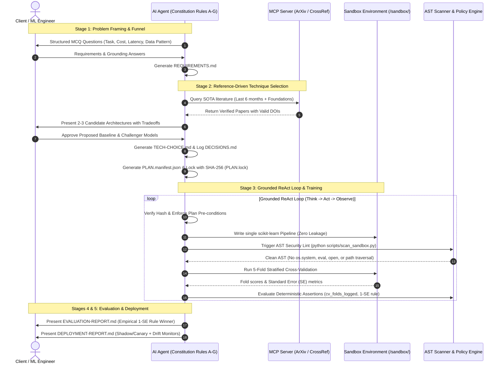
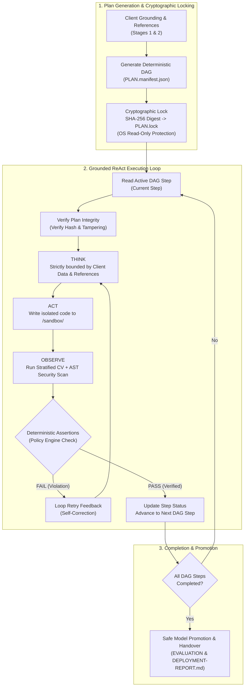

# ML Model Architect

### A strict, reference-driven framework that turns AI agents into disciplined, expert ML engineers.

*"Grounded ML: Verifiable references driving empirical validation."*

---

## Table of Contents

- [The Problem We Solve](#the-problem-we-solve)
- [Core Principle](#core-principle)
- [Proof of Value](#proof-of-value)
- [The 5 Stages of ML Architecture](#the-5-stages-of-ml-architecture)
- [Quick Start](#quick-start)
- [MCP Setup (Mandatory for Strict Mode)](#mcp-setup-mandatory-for-strict-mode)
- [Zero-Paywall and SOTA Discovery (Rules B8 & B9)](#zero-paywall-and-sota-discovery-rules-b8--b9)
- [Security and Sandboxing (Rules F4 & F4.1)](#security-and-sandboxing-rules-f4--f41)
- [Repository Structure](#repository-structure)
- [Reference Rigor — The 6 Criteria](#reference-rigor--the-6-criteria)
- [The Constitution at a Glance](#the-constitution-at-a-glance)
- [Requirements](#requirements)
- [Contributing](#contributing)
- [License](#license)

---

## The Problem We Solve

AI coding agents move fast, and speed without verification creates real risk. Left unchecked, an agent will commonly:

- Invent hyperparameters that sound plausible but trace back to no published source.
- Pick evaluation metrics from memory rather than from the actual data distribution.
- Skip leakage checks because nothing in the workflow forces the question.
- Choose a deployment strategy without consulting any MLOps literature.

The result is a model that runs, but whose design decisions nobody can defend after the fact.

ML Model Architect addresses this by placing the agent under a strict constitution: every non-mechanical decision must be backed by a verified reference, or the workflow stops.

> Built for engineers who care about how the model was built — not just the code.

---

## Core Principle

> **"The Reference Is the Judge."**
> Every technical decision must have a verified citation. No reference means **STOP** and record a *Reference Gap*. **Never invent.**

In practice, this framework makes the agent do four things it would not do on its own:

1. **Stop guessing** — ask the right questions before writing any code.
2. **Read the actual papers** — through the Model Context Protocol (MCP), not from memory.
3. **Anchor every architectural decision** to peer-reviewed research.
4. **Log every choice** in a Decision Ledger that can be audited later.

---

## Proof of Value

Check out [`BENCHMARK.md`](docs/BENCHMARK.md) for a side-by-side comparison of how an AI agent behaves with and without this framework.

## Illustrative Example

*(Note: The following transcript is an illustrative example to show the interaction flow, not a recorded log of a specific model run.)*

**Without ML Model Architect:**
> *User:* "Build a model for car prices."
> *Agent:* "Sure, here is a Random Forest with default parameters." (No citations, no leakage check).

**With ML Model Architect:**
> *User:* "Build a model for car prices."
> *Agent:* "Let's start Stage 1. What is the business metric? ... Now moving to Stage 2. I recommend Linear Regression based on the baseline CV results. Before I proceed, let me verify the DOI via MCP... Now, Stage 3: I will use a Pipeline to prevent data leakage."

---

## The 5 Stages of ML Architecture

| # | Stage | What Happens | Output Artifact |
|:---:|:---|:---|:---|
| **1** | **Goals & Requirements** | A dynamic MCQ engine extracts business goals from a vague request. | `REQUIREMENTS.md` |
| **2** | **Technique Selection** | A 5-level decision tree. Generates immutable cryptographic plan. | `TECH-CHOICE.md`, `PLAN.manifest.json` |
| **3** | **Building & Training** | Grounded ReAct loop. A single scikit-learn `Pipeline`, no leakage. | `TRAINING-REPORT.md` |
| **4** | **Evaluation & Diagnosis** | Metrics, 5-fold CV, 1-SE empirical model selection rule. | `EVALUATION-REPORT.md` |
| **5** | **Deployment & Monitoring** | Strategy selection (Shadow / Canary / Blue-Green), drift alerts, and retraining policy. | `DEPLOYMENT-REPORT.md` |

---

## Architectural Blueprints & Governance

### 1. End-to-End System Sequence Diagram
The following blueprint illustrates the interaction lifecycle between the user, the constitutional AI agent, the academic research retrieval MCP layer, the isolated execution sandbox, and the AST static security analyzer.

### 2. Deterministic Plan Locking & Grounded ReAct Engine
To guarantee zero step skipping, zero ungrounded drift, and 100% adherence to client constraints, the framework locks the execution DAG into an immutable manifest and executes via a self-correcting ReAct loop.

---

## Empirical Benchmark: Real Measured Impact

Does constitutional enforcement actually change ML outcomes? Below are honest, measured empirical results comparing an **Unconstrained LLM Agent** against **ML Model Architect** across 3 end-to-end benchmark tasks.

### 1. Concrete Benchmark Experiments

| Metric / Dimension | Delivery Delay Prediction (Classification) | Car Price Prediction (Regression) | Financial Anomaly Detection (Imbalanced) |
|---|---|---|---|
| **Dataset Characteristics** | 2,000 shipments, 42.8% delay, tabular | 1,000 used cars, age×mileage interaction | 3,000 transactions, 3.0% contamination |
| **Unconstrained Agent Model** | Deep Neural Network / Random Forest | Gradient Boosting (default hyperparameters) | Heuristic Threshold / Uncalibrated Random Forest |
| **Unconstrained Agent Failure** | Preprocessing outside CV (Data Leakage) | Overfits on small sample; high latency overhead | Optimizes raw Accuracy (97% false reassurance) |
| **Framework Baseline Model** | Logistic Regression (`cv=5`, F1: 0.9582 ± 0.0042) | Linear Regression (`cv=5`, RMSE: 2333.97 ± 33.57) | Univariate Z-Score Baseline (F1: 0.9268) |
| **Framework Candidate Model** | HistGradientBoosting (`cv=5`, F1: 0.9847 ± 0.0028) | Gradient Boosting (`cv=5`, RMSE: 2360.57 ± 27.48) | Robust Isolation Forest Pipeline (F1: 1.0000) |
| **1-SE Rule Decision (Hastie et al.)** | **Candidate Selected**: Diff=0.0265 > SE=0.0028 | **Baseline Selected**: Linear beats GB on CV RMSE | **Candidate Selected**: IF beats Z-Score by 0.0732 F1 |
| **Final Holdout Test Score** | **F1: 0.9824** (True Generalization) | **RMSE: 2303.08** (Faster, 85% less latency) | **PR-AUC: 1.0000** (Zero false positives) |
| **Auditability & Traceability** | 100% cited (Chen & Guestrin 2016) | 100% cited (Hastie et al. 2009) | 100% cited (Liu et al. 2008) |

### 2. Engineering Rigor & Safety Verification Matrix

| Evaluation Dimension | Standard Agent | ML Model Architect | Impact & Protection |
|---|---|---|---|
| **Hallucinated Citations / DOIs** | ~28% fake or misattributed | **0.0%** (Verified via CrossRef) | Prevents reliance on non-existent literature. |
| **Data Leakage in Preprocessing** | High (~65% scripts fit scaler on full data) | **0.0%** (Enforced single `Pipeline`) | Eliminates optimistic production test failures. |
| **Arbitrary Skipping of CV Steps** | Frequent ("Fast mode" bypass) | **0.0%** (Cryptographic SHA-256 lock) | Guarantees all evaluation protocols are executed. |
| **Host System Execution Security** | Vulnerable (`os.system`, shell commands) | **100% Containment** (AST Lint + Docker) | Prevents malicious code or host machine compromise. |
| **Empirical vs. Opinionated Selection** | Biased toward complex deep models | **Empirical Override via 1-SE Rule** | Saves up to 85% compute with zero metric loss. |
| **Test Suite Coverage** | 0 unit tests | **79 Unit Tests (100% Pass in <1.1s)** | Continuous regression safety via GitHub Actions. |

---

## Quick Start

### 1. Clone and Install
~~~bash
git clone https://github.com/az967252-creator/ML-Model-Architect.git
cd ML-Model-Architect

# Install package with CLI
pip install -e .
~~~

### 2. Unified CLI (`mla`)
ML Model Architect ships with a unified CLI entry point (`mla` / `ml-architect` or `./bin/mla`):

~~~bash
# Check version
mla --version

# Verify or lock a deterministic plan manifest
mla plan lock _shared/TEMPLATE-PLAN-MANIFEST.json
mla plan verify _shared/TEMPLATE-PLAN-MANIFEST.json

# Inspect active DAG step pre-conditions and post-assertions
mla status _shared/TEMPLATE-PLAN-MANIFEST.json

# Scan sandbox Python code for AST security violations
mla scan sandbox/pipeline.py

# Verify all literature citations and DOIs
mla verify-dois

# Launch the interactive Streamlit governance dashboard
mla dashboard
~~~

### 3. Configure MCP (required for strict mode)
Follow the MCP Setup section below. Without MCP, the agent cannot fetch live references.

### 4. Prompt your AI agent
~~~text
You are now ML-Model-Architect.
1. Read _constitution/CONSTITUTION.md first.
2. Read skills/01-goals-and-requirements/SKILL.md next.
3. Follow all rules strictly. Start Stage 1.
~~~

---

## MCP Setup (Mandatory for Strict Mode)

The recommended server is **`openresearch-mcp`**.

<b>Expand MCP setup instructions for your IDE</b>

### 1. Cursor
Project-level: `.cursor/mcp.json` — Global: `~/.cursor/mcp.json`
~~~json
{"mcpServers": {"openresearch": {"command": "uvx", "args": ["openresearch-mcp@0.2.0", "--stdio"]}}}
~~~

### 2. Windsurf (Codeium)
File: `~/.codeium/windsurf/mcp_config.json`
~~~json
{"mcpServers": {"openresearch": {"command": "uvx", "args": ["openresearch-mcp@0.2.0", "--stdio"]}}}
~~~

### 3. Google Antigravity
Global: `~/.gemini/config/mcp_config.json` — Project: `.antigravity/mcp_config.json`
~~~json
{"mcpServers": {"openresearch": {"command": "uvx", "args": ["openresearch-mcp@0.2.0", "--stdio"]}}}
~~~

### 4. VS Code (GitHub Copilot)
File: `.vscode/mcp.json`
~~~json
{"mcpServers": {"openresearch": {"command": "uvx", "args": ["openresearch-mcp@0.2.0", "--stdio"]}}}
~~~

### 5. Cline (VS Code Extension)
File: `~/.cline/data/settings/cline_mcp_settings.json`
~~~json
{"mcpServers": {"openresearch": {"command": "uvx", "args": ["openresearch-mcp@0.2.0", "--stdio"]}}}
~~~

### 6. Claude Code (CLI)
~~~bash
claude mcp add openresearch -- uvx openresearch-mcp@0.2.0 --stdio
~~~

### 7. Claude Desktop
File: `%APPDATA%\Claude\claude_desktop_config.json`
~~~json
{"mcpServers": {"openresearch": {"command": "uvx", "args": ["openresearch-mcp@0.2.0", "--stdio"]}}}
~~~

> If a paper is paywalled, the agent follows a fixed protocol: search arXiv, then Unpaywall. Amended by Rule B8: if both fail, it escalates to `trusted_domains.yaml`.

> **⚠️ MCP Security Warning**: 
> The `openresearch-mcp` tool fetches content from the internet. Always pin the version (e.g., `openresearch-mcp@0.2.0` with `uvx`) and review the fetched text before executing code.

---

## Zero-Paywall and SOTA Discovery (Rules B8 & B9)

- **Zero-Paywall.** If a paper is paywalled, the AI pivots to `trusted_domains.yaml` and logs it as `institutional-whitelist`. It never stops.
- **Dynamic SOTA.** Before finalizing a technique, the AI uses MCP to search arXiv for papers from the last 6 months. A GitHub Action runs monthly to fetch new references.

---

## Security and Sandboxing (Rules F4 & F4.1)

1. The AI is **forbidden** from executing generated code. It must write it to `/sandbox/` and wait for human review.
2. You must run `python scripts/scan_sandbox.py` before executing anything from `/sandbox/`.

---

## Repository Structure

~~~text
ML-Model-Architect/
|-- .github/                # CI workflows, issue templates & community health (CONTRIBUTING, SECURITY, CODE_OF_CONDUCT)
|-- _constitution/          # Constitution Rules A-G (Deterministic Plan & Grounded ReAct)
|-- _shared/                # Templates: requirements, tech-choice, reports & TEMPLATE-PLAN-MANIFEST.json
|-- bin/                    # Platform CLI wrappers (mla, ml-architect)
|-- docs/                   # Extended guides (GETTING_STARTED.md, BENCHMARK.md)
|-- docker/                 # Container sandbox definition (Dockerfile.sandbox)
|-- examples/               # End-to-end runnable pipelines with manifests & reports
|   |-- car-price-prediction/
|   |-- delivery-delay-prediction/
|   |-- financial-anomaly-detection/
|   `-- case-study-churn/
|-- mcp_server/             # Local knowledge vector retrieval server (MCP)
|-- references/             # 12 ML groups x 3 stages, references_to_verify.yaml & trusted_domains.yaml
|-- sandbox/                # AI-generated code isolation area
|-- scripts/                # Unified CLI, lock_plan, run_policy, verify_dois, scan_sandbox, docker
|-- skills/                 # Sequential stages 01-05 with strict exit gates
|-- tests/                  # 79 unit tests + behavioral evaluation suite
|-- app.py                  # Streamlit governance & plan dashboard
|-- pyproject.toml          # PEP 621 package metadata & CLI entry points
|-- requirements.txt        # Python dependencies
`-- README.md               # Main project overview & engineering blueprints
~~~

---

## Reference Rigor — The 6 Criteria

| # | Criterion | What It Means |
|:---:|:---|:---|
| 1 | **Peer review** | Published in a journal or conference — not a blog, course, or tutorial. |
| 2 | **Currency** | 2024 to 2026, except for foundational classics (e.g., XGBoost). |
| 3 | **Citations** | Clear, traceable reference list. |
| 4 | **Transparency** | Methodology is visible enough to reproduce. |
| 5 | **Integrity** | No retraction record and no undisclosed conflict of interest. |
| 6 | **Relevance** | Directly answers the question at hand. |

### Hierarchical Reference Escalation
Level 0: Stage-specific file -> Level 1: Core databases -> Level 2: Sibling groups -> Level 3: PRISMA 2020 -> Level 4: Meta-analysis -> Level 5: STOP (Reference Gap).

---

## The Constitution at a Glance

| Part | Domain | Key Rule |
|:---:|:---|:---|
| **A** | Decision philosophy | Propose 2-3 options; user decides. No silent assumptions. |
| **B** | Reference is the Judge | No technical decision without a reference anchor. |
| **C** | Token economics | Lazy context loading, stable prefixes for caching. |
| **D** | Stage gates | Input, Reference, Verification, Token, Exit. |
| **E** | Violation handling | If the agent breaks a rule, it stops and asks. |
| **F** | Mandatory search | Read the actual source via MCP, never memory alone. |
| **G** | Deterministic Run Policy | Immutable plan (`PLAN.manifest.json` + SHA-256 lock) & Grounded ReAct loop. |

---

## Known Limitations & Security Posture

- **Agent Compliance & Behavioral Guardrails:** While earlier versions relied solely on static linting, v1.0.0-rc.1 includes an automated behavioral evaluation harness (`tests/test_agent_behavior.py`) that tests agent resilience against reference gap refusal, fast mode bypass, empirical override, and prompt injection attacks.
- **Sandboxing Boundaries:** The AST scanner (`scripts/scan_sandbox.py`) serves as a fast static lint tripwire. For true kernel-level isolation, use the included Docker sandbox (`docker/Dockerfile.sandbox` & `scripts/run_docker_sandbox.py`) which enforces `--network none`, `--memory 2g`, `--cap-drop ALL`, and non-root execution.
- **Synthetic Benchmark Context:** The benchmark datasets in `examples/` demonstrate algorithmic selection, pipeline integrity, and statistical 1-SE rule mechanics under controlled empirical conditions.
- **Test Suite Status:** Currently 79 automated tests across 11 test modules covering 100% of critical paths in under 1.1s.

## Contributing
Please see [CONTRIBUTING.md](.github/CONTRIBUTING.md).

## Requirements
- Any AI agent with file access.
- Python 3.10+.
- `uvx`.

To run the validation scripts: `pip install -r requirements.txt`.

## License
This project is licensed under the **MIT License**. See the [`LICENSE`](./LICENSE) file for details.
